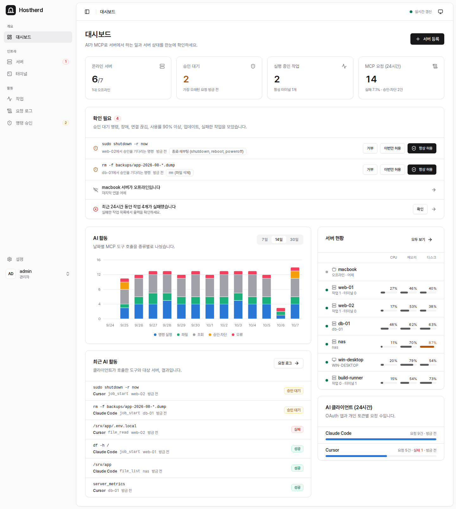
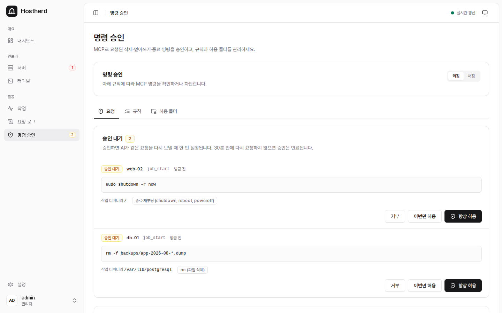
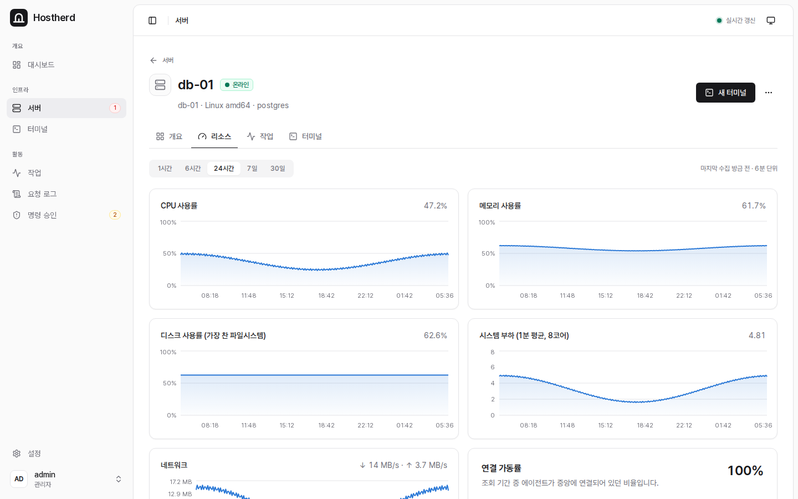
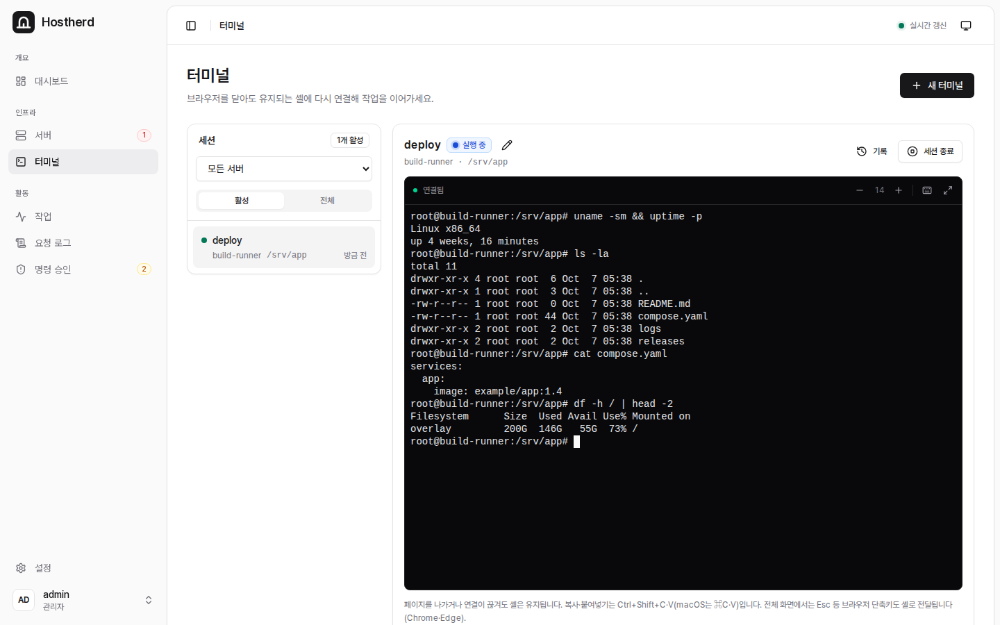

# Hostherd

[English](README.md)

Hostherd는 직접 운영하는 서버용 MCP 게이트웨이입니다. Claude, ChatGPT, Cursor, VS Code 같은 AI 클라이언트가 하나의 MCP 주소로 연결해, 등록한 모든 서버에서 명령을 실행하고 파일을 읽고 쓰고 주고받으며 스크린샷을 볼 수 있습니다. 웹 콘솔에서도 같은 일을 직접 하고 AI가 한 일을 확인할 수 있습니다.



- **명령·파일·터미널**: Linux(systemd), macOS, Windows의 amd64·arm64를 지원합니다. 각 서버는 설치할 때 고른 OS 계정으로 모든 작업을 실행합니다.
- **웹 콘솔**: 브라우저를 닫아도 유지되는 터미널, 작업 기록과 전체 출력, 모든 MCP 호출의 요청 로그.
- **명령 승인**: 삭제·덮어쓰기·종료와 직접 만든 규칙에 해당하는 명령은 승인한 뒤에 실행되도록 할 수 있습니다.
- **모니터링**: 서버별 CPU·메모리·디스크·네트워크 차트와, 승인 요청·연결 끊김·장애·높은 사용률·작업 실패를 Slack·Discord·Telegram·직접 만든 주소로 보내는 웹훅.
- **MCP 인증**: OAuth 또는 개인 토큰.
- 영어·한국어 화면.

구성은 둘입니다. 웹 콘솔과 MCP 주소를 제공하는 **중앙 서버**(이 저장소의 Docker 이미지)와, 대상 서버마다 설치하는 작은 **에이전트**입니다. 에이전트가 WebSocket(HTTPS)으로 중앙에 먼저 연결하므로 대상 서버는 들어오는 포트를 열 필요가 없습니다. 에이전트 실행 파일은 서명되어 있고, 에이전트는 설치할 때 받은 키로 모든 업데이트를 검증합니다.

## 빠른 시작

Docker와 Compose가 설치된 Linux 호스트와 그 호스트를 가리키는 도메인이 필요합니다. 표준 `compose.yaml`은 HTTPS 인증서를 자동으로 받는 Caddy 프록시(80·443 포트)와 함께 Hostherd를 실행하며, 이를 끄고 직접 운영하는 리버스 프록시를 쓸 수도 있습니다. 자세한 절차는 [docs/ko/install.md](docs/ko/install.md)를 봅니다.

```sh
mkdir hostherd && cd hostherd
curl -fsSLO https://raw.githubusercontent.com/dyllislev/hostherd/main/compose.yaml
curl -fsSLO https://raw.githubusercontent.com/dyllislev/hostherd/main/Caddyfile
curl -fsSL https://raw.githubusercontent.com/dyllislev/hostherd/main/.env.example -o .env
# .env에서 PUBLIC_URL을 HTTPS 주소로 지정
docker compose up -d
docker compose logs hostherd | grep "setup token"
```

브라우저에서 `PUBLIC_URL`을 열어 초기 설정 코드로 관리자 계정을 만듭니다. 그다음 **서버 → 서버 등록**에서 서버를 등록하고, 발급된 설치 명령을 그 서버에서 실행합니다.

AI 클라이언트가 쓰는 MCP 주소는 `<PUBLIC_URL>/mcp`입니다. 클라이언트별 설정 방법은 **설정 → MCP 연결**에 있습니다.

## 화면

명령 승인: MCP로 요청된 삭제·덮어쓰기·종료 명령은 허용하거나 거부할 때까지 여기서 기다립니다.



서버의 리소스 탭: 고른 기간의 CPU·메모리·디스크·시스템 부하·네트워크.



브라우저 터미널: 페이지를 닫아도 셸은 계속 실행됩니다.



## 문서

- [설치](docs/ko/install.md): 요구 사항, 리버스 프록시, 첫 로그인, 서버 추가, MCP 클라이언트 연결
- [운영](docs/ko/operations.md): 업데이트, 백업, AI 클라이언트에서 쓰는 MCP 도구, 명령 승인, 웹훅, 에이전트 제거, 문제 해결, 직접 이미지 빌드
- [보안 정책](SECURITY.md)

## 라이선스

Hostherd는 [Elastic License 2.0](LICENSE)으로 소스를 공개합니다. 업무용을 포함해 무료로 사용하고, 직접 운영하고, 수정할 수 있습니다. 다른 사람에게 호스팅·관리형 서비스로 제공하거나 라이선스 키 기능을 제거·우회하는 것은 허용되지 않습니다. 법적 효력은 영문 라이선스 원문에 따릅니다.
