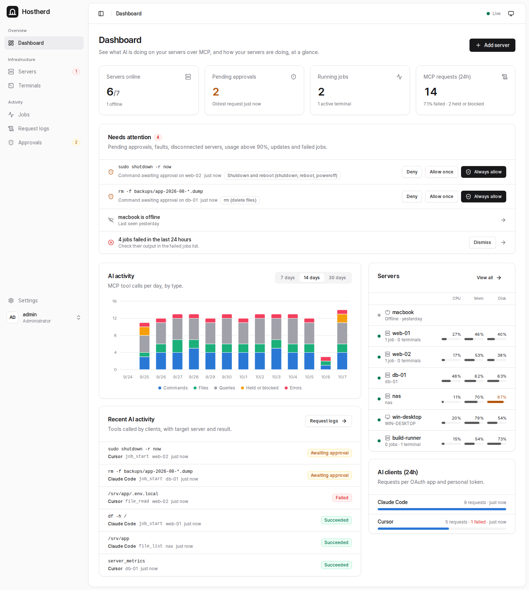
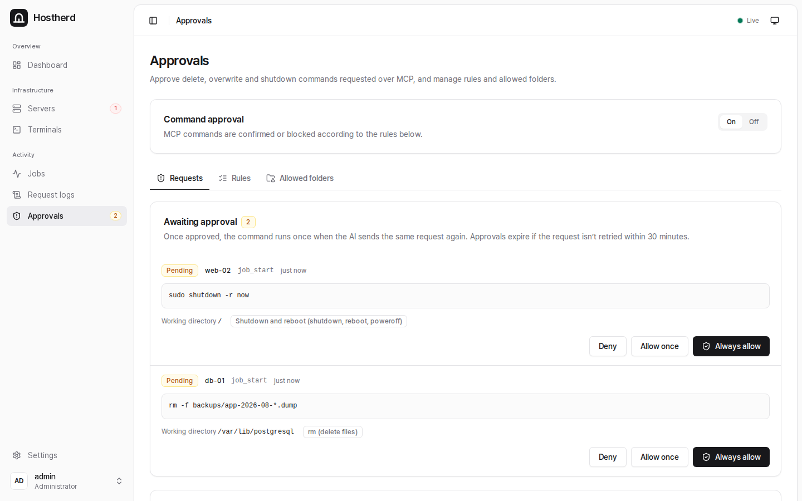
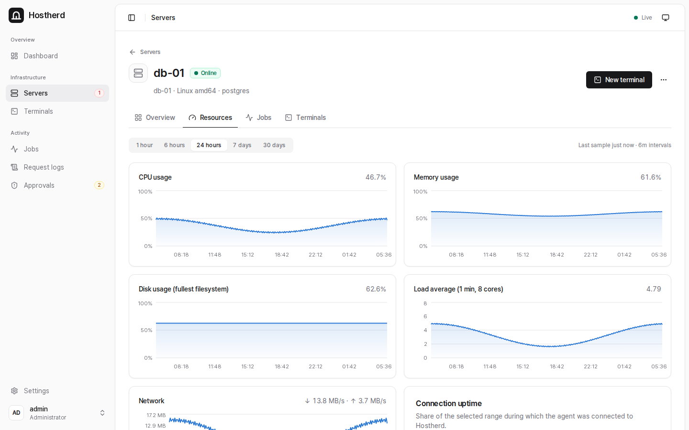
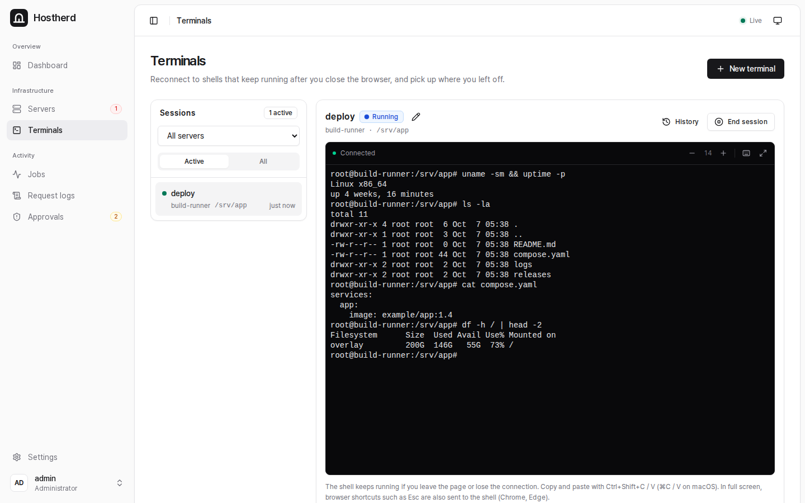

# Hostherd

[한국어](README.ko.md)

Hostherd is a self-hosted MCP gateway to your servers. AI clients such as Claude, ChatGPT, Cursor and VS Code connect to one MCP address and can run commands, read and write files, transfer files and look at screenshots on every server you register. A web console lets you do the same by hand and see what the AI did.



- **Commands, files and terminals** on Linux (systemd), macOS and Windows, amd64 and arm64. Each server runs everything as the OS account you choose at install time.
- **Web console** with persistent terminals that survive closing the browser, job history and full output, and a request log of every MCP call.
- **Command approvals**: deletes, overwrites, shutdowns and your own rules can wait for your approval before they run.
- **Monitoring**: CPU, memory, disk and network charts per server, plus webhooks (Slack, Discord, Telegram or your own endpoint) for approvals, disconnects, faults, high usage and failed jobs.
- **MCP authentication** with OAuth or personal tokens.
- English and Korean user interface.

It has two parts: the **central server** (this repository's Docker image), which serves the web console and the MCP endpoint, and a small **agent** installed on each target server. The agent connects out to the central server over WebSocket (HTTPS), so target servers need no open inbound ports. Agent binaries are signed; agents verify every update against the key they were installed with.

## Quick start

You need Docker with Compose, a domain name, and an HTTPS reverse proxy (Caddy, nginx or similar) that supports WebSockets. See [docs/install.md](docs/install.md) for the full walkthrough.

```sh
mkdir hostherd && cd hostherd
curl -fsSLO https://raw.githubusercontent.com/dyllislev/hostherd/main/compose.yaml
curl -fsSL https://raw.githubusercontent.com/dyllislev/hostherd/main/.env.example -o .env
# Edit .env: set PUBLIC_URL to your HTTPS address
docker compose up -d
docker compose logs hostherd | grep "setup token"
```

Point your reverse proxy at `127.0.0.1:3000`, open `PUBLIC_URL` in a browser, and create the admin account with the setup token. Then register a server in **Servers → Add server** and run the install command it gives you on that server.

The MCP address for AI clients is `<PUBLIC_URL>/mcp`. **Settings → MCP** shows the setup for each client.

## Screenshots

Command approvals: deletes, overwrites and shutdowns requested over MCP wait here until you allow or deny them.



Resources tab of a server: CPU, memory, disk, load and network over the selected range.



A persistent terminal in the browser; the shell keeps running after you close the page.



## Documentation

- [Installation](docs/install.md): requirements, reverse proxy, first login, adding servers, connecting MCP clients
- [Operations](docs/operations.md): updates, backups, MCP tools for AI clients, approvals, webhooks, uninstalling agents, troubleshooting, building your own image
- [Security policy](SECURITY.md)

## License

Hostherd is source-available under the [Elastic License 2.0](LICENSE). You can use, self-host and modify it for free, including at work. You may not offer it to others as a hosted or managed service, and you may not remove or circumvent any license key functionality.
